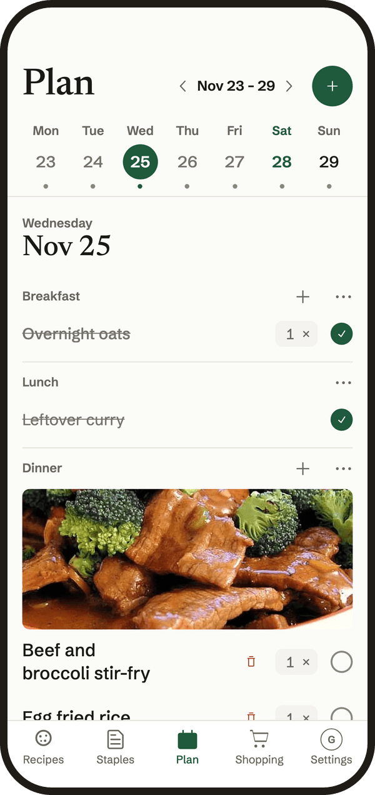
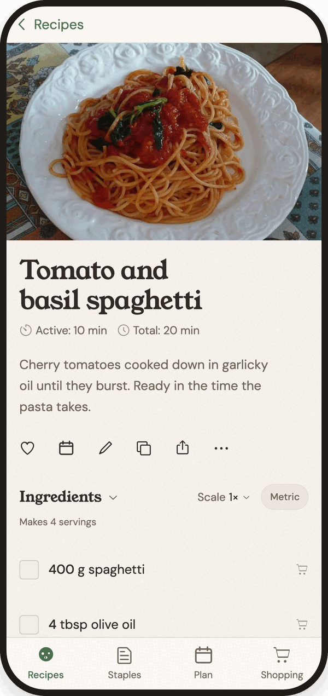
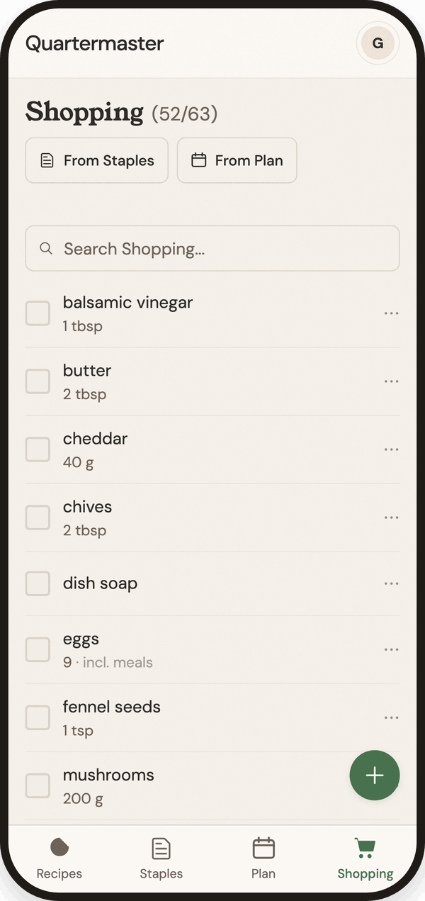
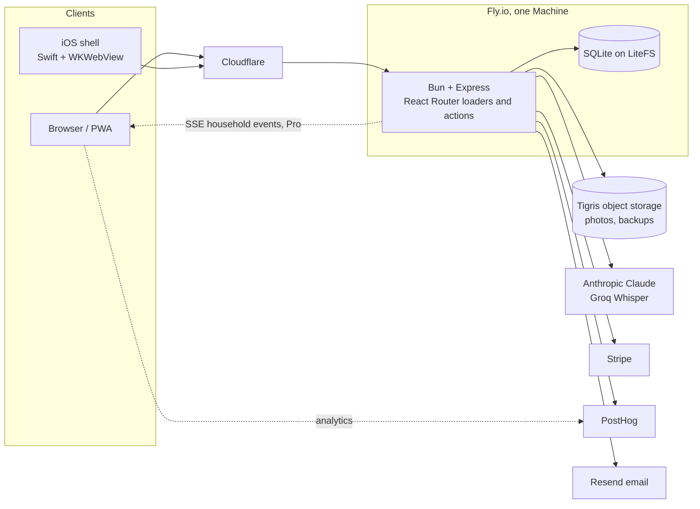

# Quartermaster

[](https://github.com/the-artifabrian/quartermaster/actions/workflows/deploy.yml)

Pick this week's dinners and the shopping list follows.

I built it because 100 recipes in Apple Notes is not a meal plan. My partner
and I use it every day on our phones. It runs at [useqm.app](https://useqm.app).

**[Try the demo](https://useqm.app).** One tap on the homepage gives you your
own copy of a lived-in Household for two hours, with 14 Recipes and a week
already under way. No sign-up.

<p>
  
  
  
</p>

## What it does

Paste a link, some text or a screenshot and it becomes a Recipe. Put Recipes
and reusable Menus on the week as Meals. When it's time to shop, open From
Plan, pick the Meals you're shopping for, and their ingredients land on one
list. Anything you keep as a Staple starts unticked, so you don't buy what's
already in the cupboard.

AI reads Recipes from pasted text and screenshots, and turns what you say into
Shopping items. Links are read from the page's own recipe data. AI is optional,
and without an API key everything works by hand.

Capitalised words like Recipe and Staple are product terms, defined in
[GLOSSARY.md](GLOSSARY.md).

## How it's built

- **Made for two phones.** On Pro, Shopping updates live on both.
  [How](docs/ARCHITECTURE.md#keeping-loader-data-fresh)
- **One small machine.** SQLite on a single Fly Machine, with nightly backups,
  a restore rehearsed against real backups, and watchdogs that restart it if
  it stalls.
- **A demo without sign-up.** Each visitor gets a two-hour copy of a sample
  Household.
- **The iOS app wraps the web app** in a small Swift shell, so one codebase
  serves both. [ADR 0002](docs/adr/0002-small-native-shell.md)

## Architecture



The details, from the data model to how loader data stays fresh, are in
[docs/ARCHITECTURE.md](docs/ARCHITECTURE.md).

## Stack

| Layer   | Tech                                                         |
| ------- | ------------------------------------------------------------ |
| Runtime | Bun, Express 5                                               |
| App     | React Router 8, React 19, TypeScript                         |
| Data    | Prisma 7, SQLite, LiteFS                                     |
| UI      | Tailwind CSS 4, Radix UI                                     |
| Auth    | Passwords, passkeys, emailed codes, TOTP                     |
| AI      | Claude Haiku (text) and Sonnet (photos), Groq Whisper        |
| Billing | Stripe (Pro is a reference implementation, see GLOSSARY)     |
| iOS     | Swift shell, TestFlight only                                 |
| Hosting | Fly.io, Cloudflare, Tigris                                   |
| Tests   | Vitest, Playwright, oxlint                                   |

## Tests and CI

- Vitest runs against real SQLite; race tests open a second connection on a
  worker thread.
- Playwright drives the real UI on a production build.
- oxlint, TypeScript, Vitest and Playwright must pass before a merge, and
  merging to `master` deploys.
- The testing rules are in [AGENTS.md](AGENTS.md#testing).

## How I work

I build this with AI coding agents. I decide what to build and judge how it
looks; agents write most of the code, and a separate agent reviews each pull
request.
[docs/HOW_I_WORK.md](docs/HOW_I_WORK.md) has the details.

## Trade-offs

- **One machine.** No failover, and a deploy restarts the app. For a household
  app on a few dollars a month, a rehearsed restore is worth more than a second
  region.
- **Started from the [Epic Stack](https://www.epicweb.dev/epic-stack).** It
  saved weeks of auth and deploy setup, and meant owning code I didn't write. A
  review in November 2026 went through it, and Google sign-in and an unused
  permissions model came out.
- **Pro is a reference implementation.** Checkout, the webhooks and the tier
  checks are built and tested, but Pro isn't on sale. The demo runs as Pro. The
  iOS app doesn't sell or mention Pro
  ([ADR 0001](docs/adr/0001-keep-pro-out-of-the-ios-app.md)).
- **AI reads, people decide.** Import transcribes, and suggestions wait for a
  tap. AI quantity planning was tried and removed, because checking its numbers
  was harder than setting them by hand.

## Getting started

Requires [Bun](https://bun.com/) 1.3.13, the version CI and production use.

```bash
bun install
cp .env.example .env
bun run setup
bun run dev
```

Open [localhost:3000](http://localhost:3000) and log in as `sam` with the
password `local-only`. Sam's Household has sample Recipes, plus a Plan and
Shopping for the week you first seed. `robin`, with the same password, has an
empty Household for trying invites. The seed is sample data for a local
database only, and it refuses to run in production.

Seeding again puts back any sample Recipe or Staple you deleted without making
copies, and leaves the Plan and Shopping alone once that week is over. To start
over on the current week, reset the local database and seed it again. Prisma's
reset doesn't run the seed by itself.

```bash
bunx prisma migrate reset --force
bunx prisma db seed
```

The development environment mocks Stripe, storage, email and AI. See
[`.env.example`](.env.example) for optional service configuration.

## Docs

- [Architecture](docs/ARCHITECTURE.md)
- [How I work](docs/HOW_I_WORK.md)
- [Product terms](GLOSSARY.md)
- [Design system](docs/DESIGN_SYSTEM.md)
- [Copy guide](docs/COPYWRITING.md)
- [Database restore runbook](docs/RESTORE.md)
- [Architecture decision records](docs/adr)
- [iOS app](ios/README.md)
- [Agent notes and testing rules](AGENTS.md)

## License

[MIT](LICENSE)
